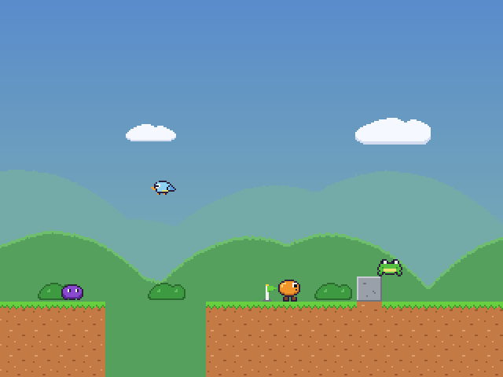
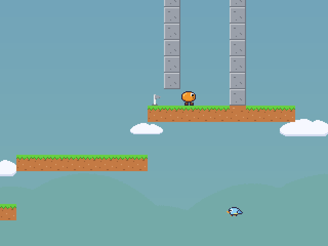

# scroller

A small 2D platformer that boots on bare-metal x86_64 through UEFI: no operating system, no libc. Freestanding C++23,
some C23 and GNU assembly, built with CMake and GCC. It runs in QEMU, from a USB stick, or over the network on a real PC.

| | |
|---|---|
|  |  |

## The game

- 15 levels: on the ground, underground, in the sky, up mountains and through a pyramid labyrinth; long, tall, or
  both; scrolling in all four directions; after the last one, THE END.
- Running, jumping with variable height, duck-jumps (50 % higher), wall-jumps.
- Bottomless pits and checkpoints; walkers, jumpers and birds to avoid (they cannot be defeated).
- Parallax background (clouds, hills, bushes); 320x240 pixel art, scaled to the screen with sharp pixels.
- Chiptune music, a tune per level (Bach, Petzold, Pachelbel, Mozart), and sound effects; Intel HD Audio or Sound
  Blaster 16.
- Plain-text levels, sprites and songs ([docs/ASSETS.md](docs/ASSETS.md)); every level is checked for a reachable goal
  and no dead ends by `levelcheck`, which plays the real physics.

### Keys

| Key | |
|---|---|
| Left / Right | run |
| Up or Space | jump (hold for higher) |
| Down | duck; jump while ducking, or hold Down for 1 s, for a duck-jump |
| + / - , M | volume, mute |
| N | music on/off (off at start) |
| Esc | key help (pauses the game) |
| F1 | statistics overlay |
| F2 | skip to the next level |
| Ctrl+Alt+R | reload the current build from the network-boot server |
| Ctrl+Alt+Delete | reboot |

PS/2 and USB keyboards both work (USB keyboards can be plugged in while the game runs).

## Quick start

Prerequisites (Ubuntu packages, OVMF, QEMU) are listed in [docs/WORKFLOW.md](docs/WORKFLOW.md).

```sh
cmake --preset uefi && cmake --build --preset uefi    # build/uefi/scroller.efi and scroller.img
scripts/run-qemu.sh                                     # play in QEMU
cmake --preset host && cmake --build --preset host && ctest --preset host   # host unit tests and level checks
```

`build/uefi/scroller.img` can be written to a USB stick (see [docs/WORKFLOW.md](docs/WORKFLOW.md)); Secure Boot must be
off.

## Developing on real hardware

The game owns the machine after UEFI hands it over: its own interrupt handling, timer, keyboard (PS/2 and xHCI USB),
sound (HDA, SB16), display timing (Intel scanline vsync) and network drivers (Intel e1000, Realtek RTL8168). Over
Ethernet a test PC can boot the game from the development PC, and `tools/devlink.py` talks to the running game: its
log, screenshots, injected keys, memory, a gdb server (`tools/devlink.py gdb`, also from VS Code) and a hot reload
that starts a new build in about a second without rebooting. Details in [docs/WORKFLOW.md](docs/WORKFLOW.md).

## Documentation

- [docs/ARCHITECTURE.md](docs/ARCHITECTURE.md): decisions, boot phases, source layout, drivers, freestanding rules
- [docs/PLAN.md](docs/PLAN.md): milestones and what is next (including cooperative network play)
- [docs/WORKFLOW.md](docs/WORKFLOW.md): build, run, debug, USB sticks, network boot, the debug link
- [docs/ASSETS.md](docs/ASSETS.md): level, sprite and music formats, `levelcheck`, the level and song generators
- [docs/HARDWARE.md](docs/HARDWARE.md): the test machines
- [docs/REFERENCES.md](docs/REFERENCES.md): manuals and specifications
